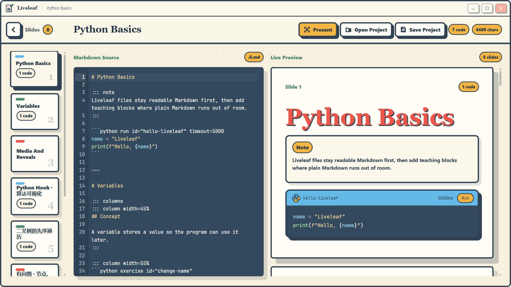

<div align="center">


# Liveleaf 活页

**面向计算机课程的 Markdown 优先教学工具**

用一份 Markdown 写课件，在课堂上放映，代码当场运行，算法执行过程可视化回放，课后把同一份文件发给学生。


</div>



## 为什么做 Liveleaf

讲编程课时，PowerPoint 放不了能运行的代码，Jupyter Notebook 又不适合放映。Liveleaf 介于两者之间：

- **比 PowerPoint 轻**：课件就是纯文本 Markdown，可以用 Git 管理，跨学期复用和修改。
- **比 Notebook 更适合放映**：按 `---` 分页，支持分栏、提示框、媒体等版式。
- **源文件可读、可移植**：特制语法尽量兼容标准 Markdown，在其他 Markdown 阅读器中也能正常阅读。

## 功能

| 模块 | 说明 |
| --- | --- |
| 📝 编辑与预览 | 左侧源码、右侧实时预览；编辑器支持行号、缩进、撤销/重做和语法高亮 |
| 🎞️ 幻灯片放映 | `---` 分页，全屏放映，键盘翻页 |
| ▶️ 可运行代码块 | 课件中的 Python 代码块可直接运行，显示 stdout、stderr、异常和超时结果 |
| 🔍 算法可视化 | 数组、二叉树、有向图、动态表格；按执行步骤回放，算法代码无需导入任何绘图库 |
| 🧩 教学容器 | `note` / `tip` / `warning` / `danger` / `question` / `hint` / `solution` |
| 📐 版式扩展 | 多栏布局 `columns`，视频 `::video`，音频 `::audio` |
| 📦 项目包 | 把课件源码和本地图片、音视频等资源打成单个 `.llpkg` 文件分发 |
| 🤖 CLI | 无界面命令行，以带版本号的 JSON 输出校验、检查、运行和打包结果，方便 AI 和脚本调用 |

语法高亮覆盖 Python、JavaScript/JSX、TypeScript/TSX 和 JSON，编辑器、预览、放映和回放中的配色一致。其他语言按纯文本显示。

## 语法速览

Liveleaf 课件使用 `.ll.md` 扩展名，本质上是 Markdown 文件。

````markdown
# 冒泡排序

::: note
相邻元素两两比较，较大的值逐步“冒泡”到末尾。
:::

```python run id="bubble" visualize="array" watch="values" pointers="i,j"
values = [5, 2, 4, 1, 3]
for i in range(len(values)):
    for j in range(len(values) - 1 - i):
        if values[j] > values[j + 1]:
            values[j], values[j + 1] = values[j + 1], values[j]
```

---

# 练习

```python exercise id="practice"
def double(value):
    return value * 2
```

::: solution collapsed
`return value * 2`
:::
````

### 可视化类型

在代码围栏上用属性声明要观察的变量，Liveleaf 会记录每一步的状态，运行结束后可以逐步回放。

| `visualize=` | 观察的数据 | 指针 `pointers` 的含义 |
| --- | --- | --- |
| `array` | 标量 list | 数组下标 |
| `tree` | 节点 dict 或普通对象（字段名用 `value` / `children` 指定） | 节点引用 |
| `graph` | 邻接 dict：`{节点: {邻居: 权重}}` 或 `{节点: [邻居]}` | 节点键 |
| `dynamic-table` | 由标量、记录 dict 或二维 list 组成的数组 | 不适用 |

图还可以用 `node_states` / `edge_states` 绑定节点和边上的任意具名状态（如距离、是否已访问）。任何可视化都可以用 `tables="rows"` 附加一张独立的动态表格，跟主视图同步回放。

完整语法见 [特制语法清单](./docs/syntax-reference.md)。可直接运行的示例：

- [数组与二叉树先序遍历](./docs/examples/python-visualization.ll.md)
- [有向图、Dijkstra 最短路径与动态表格](./docs/examples/dijkstra.ll.md)

这两个示例也包含在应用启动时加载的入门课件里。

## 快速开始

### 环境要求

- [Node.js](https://nodejs.org/) 与 [pnpm](https://pnpm.io/)
- [Rust](https://www.rust-lang.org/tools/install) 及 [Tauri 2 的系统依赖](https://tauri.app/start/prerequisites/)
- 运行代码块需要本机安装 **CPython 3.10 及以上版本**（Windows 下依次查找 `python`、`py`，其他平台依次查找 `python3`、`python`）

### 安装与运行

```bash
pnpm install

# 启动桌面应用（开发模式）
pnpm tauri dev

# 构建桌面安装包
pnpm tauri build
```

`pnpm dev` 只启动 Vite 前端，Python 运行等功能依赖 Tauri 后端，需要在桌面应用中使用。

### 放映快捷键

| 按键 | 操作 |
| --- | --- |
| `→` `↓` `PageDown` `Space` `Enter` | 下一页 |
| `←` `↑` `PageUp` `Backspace` | 上一页 |
| `Shift` + `↓` / `↑` | 在当前页内上下滚动 |
| `Esc` | 退出放映 |

## 命令行工具

`liveleaf-cli` 与桌面端共用 Rust 解析器、Python 运行器和打包器，不需要启动窗口，适合 AI 生成课件后自动校验，也适合 CI 使用。

```bash
pnpm cli:build    # 产物在 src-tauri/target/release/liveleaf-cli(.exe)

liveleaf-cli spec --json                                   # 当前支持的语法和能力说明
liveleaf-cli validate lesson.ll.md --json                  # 静态校验，不执行代码
liveleaf-cli inspect  lesson.ll.md --json                  # 输出文档结构模型
liveleaf-cli run      lesson.ll.md --cell hello --json     # 运行指定代码块
liveleaf-cli pack     lesson.ll.md -o lesson.llpkg --json  # 打包为项目包
```

启用 `--json` 后，stdout 始终只输出一个 JSON 对象。退出码 `0` 表示成功，`1` 表示校验或执行失败，`2` 表示参数或环境错误。完整协议见 [CLI 文档](./docs/cli.md)。

## 项目结构

```text
.
├── src/                    # Vue 3 前端
│   ├── code/               # CodeMirror 编辑器与语法高亮
│   ├── markdown/           # 前端文档模型
│   ├── runtime/            # Python 运行客户端与可视化数据处理
│   ├── visualization/      # 数组 / 树 / 图 / 动态表格视图与回放播放器
│   └── window/             # 自定义窗口框架
├── src-tauri/              # Tauri 2 + Rust 后端
│   ├── src/
│   │   ├── markdown.rs     # 课件解析器
│   │   ├── validation.rs   # 静态校验
│   │   ├── runtime/        # Python 进程管理
│   │   ├── project_package.rs  # .llpkg 打包与读取
│   │   ├── cli/            # CLI 实现
│   │   └── bin/liveleaf-cli.rs
│   ├── python/
│   │   ├── runner.py       # 代码块执行入口
│   │   ├── liveleaf_viz/   # 可视化 Hook：追踪变量并生成回放帧
│   │   └── tests/
│   └── tests/cli.rs        # CLI 集成测试
├── tests/                  # 前端单元测试
└── docs/                   # 设计文档与示例
```

## 测试

```bash
pnpm build                                          # 类型检查与前端构建
pnpm test                                           # 前端测试
cargo test --manifest-path src-tauri/Cargo.toml     # Rust 测试（含 CLI 集成测试）
python -m unittest discover -s src-tauri/python/tests  # Python 可视化 Hook 测试
```

未安装 Python 时，CLI 集成测试会跳过需要实际执行代码的用例。

## 文档

- [产品需求](./docs/product-requirements.md)
- [技术架构](./docs/technical-architecture.md)
- [Markdown 语法设计](./docs/markdown-syntax.md) · [特制语法清单](./docs/syntax-reference.md)
- [Python 运行时设计](./docs/python-runtime-design.md)
- [Python Hook 可视化设计](./docs/python-visualization-hook-design.md) · [有向图扩展](./docs/python-graph-visualization.md) · [动态表格](./docs/python-dynamic-table.md)
- [CLI 与 AI 自动化接口](./docs/cli.md)
- [路线图](./docs/roadmap.md)

## 路线图

已完成：Markdown 课件查看与分页放映、版式与教学容器扩展、Python 运行时、全屏放映与 `.llpkg` 项目包、算法可视化、CLI。

计划中：

- 学生练习流程：可编辑练习块、本地保存学生改动、公开测试用例
- Notebook 式会话：跨代码块共享状态、重启和中断执行
- 更多导出格式：静态 HTML、教师版/学生版、PDF

详见 [Roadmap](./docs/roadmap.md)。

## 许可证

[MIT](./LICENSE) © 2026 Amiya114514
